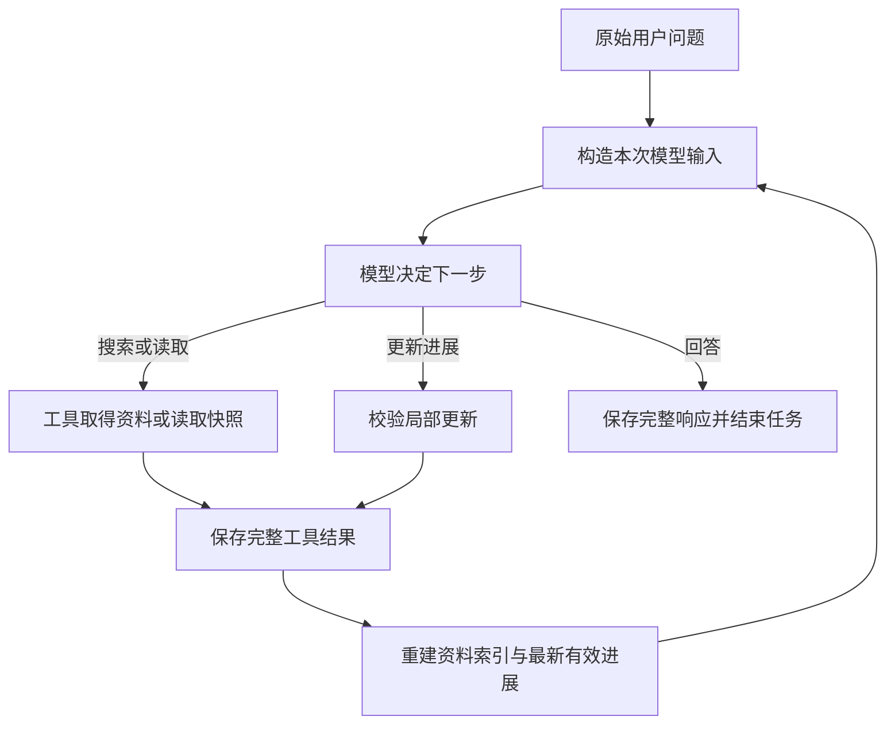

# Seekra 研究进展：当前内容、执行流程与问题证据

本文描述当前工作区实现，供维护者理解、复查和后续方案比较；不是对未来实现的要求。实验结果按各批次标注的日期与配置解释，外部做法的检索结论见 [实践比较](research-progress-practices.md)。

## 1. 整体认识

研究进展是当前研究任务的可更新工作记录。模型提出发现、适用条件、未核实事项和下一步，harness 校验格式、引用及读取入口，保存到执行记录，并把最新有效版本放进后续输入。它的目的是在长任务和上下文整理后保留工作依据。同一任务的较早版本若仍留在输入中，会标为历史进展，注明已由新版替代，并保留当时的状态和导航；只有最新版本更新当前阅读导航。原始执行记录不被改写。

这条链路包含三个不同对象：

| 对象 | 保存什么 | 谁产生 | 可以证明什么 |
|---|---|---|---|
| 原文资料 | 搜索片段、提取文本快照、小节边界、获取信息 | 获取工具取得文本，harness 建索引 | 保存了哪份文本、位置在哪里；不能证明网页提取完整或结论正确 |
| 执行记录 | 问题、完整模型消息、工具开始/完成、输入选择、保存结果、结束状态 | 执行核心 | 客户端执行过什么、保存过什么、选入了什么 |
| 研究进展 | 模型的发现、条件、判断、缺口、阅读目标与计划 | 模型提出，harness 保存 | 某次任务当时记录了哪些判断；判断本身可能错 |

例如，“页面写了连续离线 30 天后需验证”要回查正文；“用户准备离线 45 天”来自用户问题；“模型曾保存了期限重置未知这一缺口”要回查对应任务的执行记录。三者不能相互代替。

模型一直通过工具调用与 harness 沟通。它可以自然语言向用户说明计划，但只有实际调用 `update_research` 并成功提交，才会发布新进展。

## 2. 来源与正文怎样成为决策依据

首次搜索仍向模型提供标题、实际 URL、相关片段及读取入口。后台保存的是取得的规范化结果；搜索不等于已提取每个 URL 的完整正文。

`read_page(url)` 联网提取页面、保存新快照，再返回开头正文和实际目录。后续本地读取原快照不会重新联网。再次调用 `read_page` 会再次获取；取得失败不能冒充新快照。

| 编号示例 | 含义 |
|---|---|
| `S1` | 同一目标 URL 的来源身份；当前按请求 URL 原样归并 |
| `S1-R1` | 一次搜索取得的片段 |
| `S1-P1` | 一次页面提取快照 |
| `S1-P1-H3` | 从该快照实际标题标记解析出的小节 |
| `S1-P1@820-1040` | 保存文本的字符区间，结束位置不包含在区间内 |

片段与页面可以属于同一来源，但不是同一内容，也不能当成两个独立来源。多次查询与获取记录仍保留。同一 URL 的不同快照不合并覆盖范围。

小节名称和路径来自保存文本的明确标题，harness 不替作者发明语义标题。没有可靠目录时，模型可以查词或顺序阅读。这里的“原文”是保存的提取文本，不等同于完整 HTML 或网站全部内容。

| 工具 | 模型选择什么 | harness 负责什么 |
|---|---|---|
| `read_section` | 实际 `section_ref` 和返回的续读游标 | 按小节边界分页，尽量在自然段结束，不跨节 |
| `find_in_documents` | 查找词、资料、可选游标 | 区分大小写的字面匹配，返回命中附近正文与新引用 |
| `read_document(view="reference")` | 实际正文引用 | 只读引用范围，可分页 |
| `read_document(view="text")` | 资料或引用锚点 | 读取正文或展开周边，返回实际范围与新引用 |
| `read_document(view="outline")` | 已保存资料 | 返回目录及目录续读入口 |
| `list_documents` | 可选来源与游标 | 找回资料编号、获取信息和读取入口 |
| `list_history` / `read_history` | 记录编号与视图 | 回查执行经过；`review` 核对模型消息并绑定原任务、当时进展及快照；各视图偏移不可混用 |

`match_ref` 只定位命中词；`evidence_ref` 覆盖实际返回的附近正文。是否支持结论需要模型判断。未命中只说明所查文本没有该字面匹配。

常用默认值：搜索片段最多 1,200 字符，重复片段展示可缩为 200；首次读页约 1,800 字符；小节/普通正文单次最多 6,000 字符；目录单页 20 项。请求预算不足时可能进一步缩减，必须跟随实际范围和续读入口。

`complete` 表示本次是否包含整个读取目标；`reached_end` 只表示到达目标末端。末页到达末端，不表示本次包含此前全部正文。

## 3. 模型维护的完整状态

正式接口为 `update_research(base_revision, operations, goal=None, next_step=None)`。模型提交变化，harness 合并未修改内容并返回完整新状态。

| 内容 | 字段与含义 |
|---|---|
| 工作目标 | `goal`：模型概括的目标；不能替代原始用户问题 |
| 发现 | 稳定 `id`，`summary`、`conditions`、`status`、`references` |
| 发现的判断状态 | `supported`、`uncertain`、`conflicting`，均由模型选择，不是程序认证 |
| 正文引用 | 每项 1–8 个；可复制 `evidence_ref`，提交后规范化为来源、资料和区间 |
| 可选短原句 | `evidence_quotes`：每项最多三条，每条最多 400 字符；在关联引用范围内定位并保存实际原文与坐标 |
| 可选缺口关联 | `gap_ids`：发现或阅读目标关联最多四个仍存在的缺口 |
| 缺口 | 稳定 `id`、`question`、`status`、`resolution`、`references`；状态为 `open/resolved/dismissed` |
| 可选回答影响 | 缺口的 `answer_impact`：模型说明会改变哪项答案，或为何属于延伸问题 |
| 阅读目标 | 稳定 `id`，`target`、`view`、`purpose`，可带 `cursor/query/gap_ids` |
| 下一步 | `next_step`：模型的当前计划；省略保留旧值，空文本清除 |

阅读目标的 `view` 为 `section/text/reference/outline/find/page`。目标使用实际小节、资料、正文引用、明确 URL 或来源编号。程序核对目标是否存在和参数是否可解释，不验证目的是否合理。

支持的操作：

- 发现：`add_finding`、`revise_finding`、`remove_finding`。
- 缺口：`add_gap`、`revise_gap`、`resolve_gap`、`dismiss_gap`、`reopen_gap`、`remove_gap`。
- 阅读目标：`add_read_target`、`revise_read_target`、`remove_read_target`。

新增时分配 `finding-N/gap-N/target-N`，删除后不复用编号。修订、删除和关联应复制已返回编号。后端校验的是最终合并状态中的关联完整性；不能据此声称程序证明模型正确选择了关联。

`resolve_gap` 必须提交处理说明和正文引用。`dismiss_gap` 可说明为什么不再调查，引用可为空。重新打开会清除旧解决说明与引用。解决缺口不会自动删阅读目标，也不会自动更改发现判断；这些由模型决定。

每版模型状态最多 8,000 个序列化字符，包含编号、关联、原句等；最多 20 项发现、20 项缺口、10 个目标。每次最多 20 项操作。超限时返回实际大小和需减少量，不静默截断条件。旧版全量参数保留 Python 兼容入口，已进入局部更新格式后不允许再用全量覆盖。

短原句先按字面定位，再允许内联 Markdown 链接文字、反斜线转义与空白折叠的格式等价匹配。不能翻译或改写后当作原句；格式匹配不唯一时要求缩小范围。程序不判断这条原句是否足以支持整项发现。

## 4. harness 生成的状态视图

下列信息由程序根据已保存状态与交付记录生成，模型不直接填入，也不计入上述 8,000 字符状态限额；它们仍占完整请求预算。

| 视图 | 内容与边界 |
|---|---|
| `navigation` | 阅读目标的实际来源、快照、原始标题、范围、读取动作 |
| `first_undelivered` | 顺序正文/小节/引用目标内最早未交付区间和动作；中间有洞时不能仅沿最后终点推进 |
| `document_coverage` | 正在引用或选择的资料，即使目标已删除也保留；最多显示八份和每份前三段，另列省略编号/数量 |
| `ever_delivered` | 本任务历史累计交付范围：`none/part/full` |
| `current_input` | 当前最终输入中的正文或短原句覆盖：`none/part/full` |
| `gap_links` | 每个缺口对应的发现、目标编号及缺口状态 |
| `state_budget` | 模型状态实际字符数、8,000 上限和剩余量 |
| `content_changed` | 相对上版是否有内容变化；空操作也可形成新保存点 |

当前不可见不等于从未交付；曾全部交付不等于已理解。片段的 `full` 仅指片段，不代表整页。`first_undelivered` 是入口，不是要求读完所有页面。

## 5. 一次更新怎样真正生效

1. 执行核心为模型构造本次消息和工具定义，其中包含原问题、可用资料和最新有效进展。
2. 模型返回完整、通过协议校验的工具调用，核心先保存完整响应，再执行调用。
3. `update_research` 检查正在运行的任务和 `base_revision`，在副本上合并整批操作。
4. 程序检查字段、数量、状态大小、对象关联、阅读入口、引用来源及范围；发现引用必须全部位于本任务已确认交付的连续范围内。不能用两端已读掩盖中间未读部分。
5. 校验通过只生成候选结果。`tool_completed` 成功落盘后，Session 才发布最新进展与记录编号。任何校验失败不替换旧版，版本仍保持不变。
6. 下一次输入重新生成导航和可见范围，并记录实际消息选择与替换值。

资料保存、准备选择、发起请求、确认交付是不同事件。`context_selected` 记录选择；`model_started` 发布本次阶段和请求投影；只有取得完整 `model_completed`，才根据实际投影确认正文交付。目录、预览、外置正文和只在后台保存的全文都不据此成为正文证据。

存储失败会停止运行，不能继续假定记录或状态已成功发布。取消发生在工具返回之后时，已经取得的结果也先保存。

## 6. 平时保存、预算整理与供应商恢复

### 6.1 平时如何使用

系统提示建议模型在重要发现或改变方向时保存。简单问题可以直接回答，不强制每轮调用进展工具。模型应更新过时的 `next_step`，根据原问题判断缺口是否必要，但目前没有程序语义检查来保证它做到。

Seekra 不设固定模型决策次数上限。停止取决于模型回答、取消、请求/存储/预算错误等运行条件。实验的外部计时取消与产品的决策上限不是一回事。

### 6.2 何时整理旧轮次

`max_context_chars` 默认 120,000，计数对象是序列化的消息与工具定义，包含实际回传的供应商续接字段；不是 token 数，也不是模型服务的上下文窗口。

达到 80% 阈值时，先尝试通过已有有效进展推进检查点，并按软目标外置较旧工具正文。检查点保留原问题、保存进展的完整交互及后续轮次；此前的当前任务轮次退出活动输入，原执行记录和快照仍保留。提前外置不缩短最新结果组，不外置最新进展、失败详情和历史回读，也不为软目标移除旧用户任务；降到阈值以下就继续普通研究。

仍需整理且不是刚刚保存时，进入临时整理阶段：

- 开放 `update_research` 和已有引用的局部 `read_document` 回查。
- `reference` 可按同一引用的游标续读；`text` 可展开已交付引用周边纠错，不接受普通页面游标、`start/limit`。
- 普通搜索、提取、小节与页面续读暂时停用；动作标为 `after_progress`，局部入口标为 `local_reference`，具体范围仍须验证。
- 保存成功后，下一次请求恢复普通工具。同一模型响应中与保存并列的调用仍遵守该响应所属阶段。
- 模型也可以在依据足够时直接回答。不能为退出阶段编造发现或声称研究已完成。

暂时停用的调用返回 `progress_required`，不执行新获取。参数有效的普通本地读取保留 `deferred_action`；保存后由模型选择重试，不自动执行。外置提示、系统回查说明与恢复菜单使用同一阶段权限。

### 6.3 reasoning 续接与业务上下文重建

默认 `deepseek-flash` 开启 reasoning，effort 为 `high`，输出预算 8,192 token。完整响应落盘后才缓存续接字段；私有推理全文只在进程内保留，必要时进入请求并占预算，不写入历史和用户输出。

重载后缺少必要私有续接字段，或必要历史无法容纳时，harness 基于执行事实重建业务输入：

- 原始问题和最新有效研究进展。
- 最多三份资料的目录信息，每份实际小节数、前八项原始标题与读取动作，另有完整目录入口。
- 最新完整工具结果组；成功进展由最新状态表达，保存失败的具体结果仍保留。
- 有界的较早正文摘录、近期结果摘要与历史可见消息片段。

最新结果优先保留。预算不足时先移出旧摘录并列出资料入口，再用整批分配器明确裁剪新正文、更新引用与继续游标；必要状态和导航仍放不下时暂停。较早摘录不是重新取得的整页，也不是私有思考摘要。

当前窗口中出现更新后的有效进展后，恢复时的旧进展和摘录退出输入，避免把旧版当最新版。实际选入的短原句也计入可见来源范围；模型总结本身不计为原文。

### 6.4 任务、重载与 reset

恢复同一未完成任务继续其最新有效版本，但模型模式、提示词和工具配置必须兼容；已经开始、结果未知的工具不能自动重做。

新问题分配新任务编号，进展从版本 0 开始。旧任务进展属于历史资料，旧快照在当前会话允许范围内仍可查阅。reset 隔离当前资料索引与历史工具读取边界，磁盘原记录保留。

因此，当前任务的进展不能否定旧任务曾保存过什么。研究对象的来源、产生任务和当时状态需要分别核对。

模型消息的历史索引和普通回读提供 `review_action`。`read_history(view="review")` 返回该消息，并固定关联原问题、响应前最后一次已提交进展及当时获取/读取或引用的资料身份；后续更新和新快照不改写这些关联。没有当时进展时明确为 `null`，失败保存不成为关联版本。菜单最多八份资料，省略数量与后续定位入口明确列出。模型仍需选择相应入口核对；导航不认证语义，也不计为正文交付。该视图的 `start` 只属于模型消息文本，按返回的 `continuation` 续读。

## 7. 一个完整使用过程

问题：虚构产品 Windows 离线条件是什么，Pro、已下载资源包、共享访客账户连续离线 45 天是否可行？

1. 搜索片段提示有离线功能。模型根据标题、URL、片段决定打开来源。
2. 读页保存 `S1-P1`；目录提供 Supported platforms、Offline requirements、Limitations。开头正文仅支持部分条件。
3. 模型可保存已知条件，记录期限与账户缺口，选取实际小节为目标。没有读取正文的目录不能充当事实引用。
4. 模型读取相关小节，按 harness 返回的游标续读到末尾，取得 30 天后再次验证的句子；另读 Limitations，取得共享访客禁令。
5. 引用实际 `evidence_ref`，保存条件和短原句，按取得的依据更新缺口、目标及下一步。
6. 预算整理后，模型仍可依据这些记录回查同一快照。harness 不把读取完整等同于判断正确。
7. 回答指出两项已知不符。可以建议提前预留联网时间，但不能称原文要求提前；重置规则未确认时不能承诺周期方案成立。

步骤 1–6 的接口和保存机制已有实现与验证。步骤 7 的语义一致性仍不稳定，不能把前六步正常执行当作整份答案合格。

## 8. 已暴露问题及原始证据

下面区分程序缺陷、模型行为、人工评估边界和原因假设。一次完成或短原句匹配不等于整体质量通过。

### P1：原文要求、解释与建议混合

- **现象**：原句和保存进展仍是“连续离线 30 天后需验证”，最终建议却写“第 30 天前验证是文档硬性动作”。另有“只排除共享访客”被归为“非访客账户是文档必要前提”。
- **记录支持**：相关原句在最终实际输入中；后一种限定对象变化不能由引用合法性发现。若“提前”明确只是建议，本身不构成错误。
- **已有处理**：保存 `conditions/evidence_quotes`、提示保留条件与确定程度；一次临时表达指导实验，未改正式默认提示。
- **缺口**：不能保证逐条建议保持原文限定、时间和未知依赖。部分解释已在保存状态中被加强，部分首次出现在最终回答。
- **最新诊断**：2026-10-05 的逐段提取实际包含了“非访客是文档必要前提”，核对仍误判为受支持，说明问题不只在提取。提高输出预算只让部分试验完成，没有使判断可靠；通用必要性/反例指导的生成试验也未稳定改善，均未加入默认流程。原始运行、开销与边界见 [本批汇总](../evals/evidence/research-closeout-20261005.json)。
- **证据**：[具体“30 天前”运行](../evals/evidence/progress-feedback-meridian-present-5-20261004.json)，模型最终响应记录 127；此前保存记录 73/93/111/123 保留 after 原句与未知项。[常规预算与指导对照](../evals/evidence/semantic-boundary-review-20261004.json)及所链接原始运行。

### P2：进展可保存、可使用，但收益未稳定证明

- **现象**：真实模型曾根据保存目标续读、更新核心缺口并回答；也曾读完一个小节后，把整页相关问题标为解决。旧 `next_step` 曾持续指向已核对事项。
- **已有处理**：局部合并、稳定编号、缺口关联、阅读目标、实际交付视图、回答影响说明及过时计划提示。
- **缺口**：模型能否自主写好、持续利用、及时纠正进展仍需验证。预置状态测试不证明自主初始规划；同版本少量轨迹不证明稳定净收益。
- **最新观察**：两个空会话固定资料任务自主保存了有正文引用的发现与未知项；真实 Python 任务在两次原句匹配失败后利用回查入口修正保存，SQLite 任务更新了两版进展。证明这些路径能被实际使用，尚不证明相对不保存进展的稳定净收益，最终建议仍可能扩大已保存条件。
- **证据**：[进展与恢复对照](../evals/evidence/progress-feedback-review-20261004.json)。最终离线用例预置/未预置状态分别 18/8 次模型请求，导出用例分别 18/32；并非一致减少。

### P3：停止时机与无增益工作

- **现象**：有依据后仍追查延伸问题、重复查词或回查；也曾在关键尾部未读时结束并扩大“未见”的范围。
- **已有处理**：允许保留 open 缺口回答、`answer_impact` 提示原问题影响；不要求清空缺口或读完所有页面。
- **缺口**：未稳定区分必需补证与无增益扩展。调用数较少可能只是遗漏，较多也可能是必要核对，必须结合资料变化与答案评判。
- **最新反例**：缩短整理阶段提示的离线任务只保存缺口就结束，未继续取得仍可获取的关键正文；导出任务则在计时取消前重复阅读。这个提示试验未采用，减少误调用或调用总数不能代替完成判断。
- **证据**：[预算压力轨迹](../evals/evidence/progress-feedback-review-20261004.json)，[真实 Tavily 自主发现](../evals/evidence/progress-scope-live-20261004.json)。

### P4：阶段权限、恢复信息与误调用

- **曾确认的缺陷**：外置与系统提示建议使用暂时关闭的工具；最新正文在重建时缩成 1,200 字符摘录；保存失败的错误被跳过；旧摘录挤占状态；恢复仅保留选中小节而丢掉其它目录标题。
- **已有修复**：按阶段生成提示；优先最新结果并明确重分配正文；保留保存失败；预算不足先移出旧摘录；恢复原始目录与读取动作。
- **最新修复**：新增历史核对入口的 `review_action/question_action/source_history_action` 也按整理阶段标为 `after_progress`，保存后恢复。回归保护标记进入实际请求选择、预算计数及原记录不被修改。
- **仍有现象**：模型仍会发起阶段不允许的调用，后端正确阻止。最终版本四项压力测试均结束，但仍分别有 4/3/4/20 次 `progress_required`，不能称模型误用已消失。
- **证据**：[修复轮次、输入与调用记录](../evals/evidence/progress-feedback-review-20261004.json)，源码回归测试 [阶段规则](../tests/test_checkpoint.py)、[供应商恢复](../tests/test_reasoning.py)。

### P5：同模型自查不等于可靠质量认证

- **现象**：两次明确核对任务有局部修正，也有范围错误的漏判；还用当前核对状态否定旧回答当时已保存的未知项。
- **客观复查**：旧运行的工具完成记录 14 实际保存了该缺口。因此不能用当前状态或政策原文否定这条历史执行事实。
- **范围**：这是显式新核对任务，有额外调用；未接入默认自动审查。来源查证、旧任务归属与文本支持需要分开。
- **已有处理与新证据**：已实现历史核对入口，固定原任务、响应前进展和资料身份。两项新部署核对都读取旧记录 14，正确承认旧未知项；完整回答仍有范围扩大或时点归因漏判。静态单项分类正确不能证明完整审查可靠，详见 [本批实现与对照](../evals/evidence/claim-review-20261004.md)。
- **最新边界**：逐段提取、判断、修订增加调用且可能耗尽输出预算；一项成功提取 45 条表述的核对仍认可错误必要条件。实际生成试验也未证明简单语义指导足以消除这些问题，不能作为可靠自动评审门禁。
- **证据**：[核对试验汇总与旧记录证明](../evals/evidence/semantic-boundary-review-20261004.json)，[部署核对原始记录](../evals/evidence/semantic-boundary-review-relay-1-20261004.json)。

### 证据集怎样使用

| 集合 | 用途 | 限制 |
|---|---|---|
| [progress-feedback-review](../evals/evidence/progress-feedback-review-20261004.json) | 16 次真实模型运行、270 次请求；区分各修复轮次、预置状态和未预置状态 | 固定虚构资料、32,000 字符压力预算；不评 Tavily 质量；最终源版本只有四项，不能统计稳定性 |
| [semantic-boundary-review](../evals/evidence/semantic-boundary-review-20261004.json) | 8 次生成对照加 2 次显式核对，45 次真实模型请求 | 生成对照没有整理/重建；临时指导仅实验；人工判定允许忠实意译和合理推断 |
| [progress-scope-review](../evals/evidence/progress-scope-review-20261004.json) | 早期状态与原句测试，其中含 6 次真实 Tavily 调用 | 不同模式、资料与任务起点不能混为统一质量分数 |

汇总 JSON 包含原始文件名、哈希、模式、请求/工具记录和人工判断。复查先看具体原文、实际最后输入、首次改变的模型消息，再看汇总；修复前后代码与实际提示可能不同。私有 reasoning 未保存，不从外部行为断言内部推理过程。

该批完整程序检查为 250 项、249 通过、1 跳过（整理阶段模块共 17 项）。这是当时的程序契约验证，不是当前测试总数或语义成功率。语义指导、逐项对照及短版整理提示都只在实验中使用，未加入正式默认提示；来源绑定与其阶段权限标记已进入代码。本文也不把对外帖子中的经验当作当前实现保证。

2026-10-05 的 [批次汇总](../evals/evidence/research-closeout-20261005.json) 按固定资料、兼容测试配置的旧检查点、空会话普通任务及真实来源任务分别列出证据。共 110 次真实模型请求、8 次真实 Tavily 调用；真实 Python 和 SQLite 任务均完成，引用覆盖正文区间而非关键词自身。普通任务中仍有把已保存全文或局部查找写成“通读全文”的过程声明，需要按实际交付范围复查，不能以完成状态认证整份答案。

### 2026-10-05 结构化表达试验的范围

用户随后选择先讨论并试验结构化表达，再决定默认输出方式。试验把资料原文、模型场景判断、建议和未确定事项分开：模型只选择程序提供的原文段落编号，程序按稳定保存文本展示原文；判断引用这些段落，建议关联判断及未知项。没有新增自动评审，也没有改变正式输出流程。

输入组装的第一版错误跳过了紧跟标题的正文，六次运行全部排除；修正版逐段校验原文范围及非标题内容完整性。六次首次运行有四份完整答复、两次网络失败；重跑后得到一份格式正确答复及一份使用整数编号的答复。后者在同一个唯一段落池中规范化编号后通过校验，未再调用模型。最终六份可审阅答复不是六次语义认证。

原文栏的内容由程序按原段展示，能够保证这个栏位不被模型改写。未知依赖关联更明确，仍不能证明模型列全了依赖或判断正确；“接受超期风险”作为未知影响及“脱敏替代移除”等表述仍需审视。该批试验供应了完整虚构资料，当时未验证逐步研究中的已交付引用、校验失败修正和最终展示时机；这些限制描述该批证据，不代表当前实现边界。

结构化试验另有 14 次模型请求，连同前述诊断共 124 次；其中六次因输入组装错误不计质量结果。详细边界、哈希和各组原始文件见 [批次汇总](../evals/evidence/research-closeout-20261005.json)，可审阅展示见 [结构化样例](../evals/evidence/structured-answer-example-20261005.md)。

### 当前显式终稿入口

当前可显式注册 `submit_answer`，在正式执行循环中校验、保存并交付终稿。`layout` 允许模型决定标题和内容顺序，保留判断的依据与条件、建议的判断关联与未知依赖；程序检查排版覆盖，并在建议旁显示已声明的条件和未知影响。同一原文只在首次指定位置展开，范围标签区分原段、引用上下文、局部原文与保存文本中的完整小节。接口、旧调用兼容及失败恢复见 [显式终稿交付](architecture.md#显式终稿交付)。默认策略保留自由回复与即时流式输出，受控终稿是显式可选能力，不作为待完成的默认切换；显式注册不禁止普通回复结束任务。

2026-10-07 的 [自由内容块候选](../evals/evidence/flexible-answer-contract-20261007.json) 验证了自由顺序和原文填充，但两种输出契约仍有语义错误。随后保留内部关联、独立安排排版的实现经过 [三项真实模型验收](../evals/evidence/answer-layout-live-20261007.json)：共 10 次模型请求，无真实 Tavily 调用，资料为同一组固定虚构文本。三项都使用了 `layout`；一次自然遗漏原文节点的提交被拒绝，模型补齐后成功。周期验证的未知依赖得到明确关联，但仍出现把“30 天后验证”加强为提前截止的表述。程序关系完整与引用合法不能认证答案正确；这三份样本不证明语义稳定性，也未验证长任务压力下的效果。

### 条件忠实性与建议依赖

进一步回查上述离线样本，原文完整出现在终稿请求中，错误先在判断的条件字段中表现为“连续离线上限”，再在建议中加强成提前截止；该轨迹没有研究进展保存或上下文整理。随后对两个案例、两种字段说明各运行两次，共 8 次独立真实模型定稿请求，只改变四个叶字段的说明。部分表述有所改善，但重复样本仍承诺周期联网满足要求；两份因排版遗漏被拒绝的草稿也纳入审阅。本批未证明提示调整的稳定收益，候选未合入，见 [字段说明对照](../evals/evidence/claim-field-guidance-20261007.md)。

当前显式终稿已区分建议的相关未知与真正的未确认前提：`unknown_indices` 保存关联，`dependency_indices` 声明其中决定方案能否成立的前提。程序校验包含关系，对显式依赖显示候选方案状态，不因为调查动作关联未知就自动标为受阻。省略分类不证明没有依赖；状态展示也不会修正正文的确定性承诺。两次真实研究循环、8 次模型请求确认了这些声明的交付，但模型仍会遗漏计时重置依赖，并把可立即进行的调查与条件式方案混在一起。实现和 [实际样本](../evals/evidence/advice-dependencies-example-20261007.md) 只支持这个程序边界，不能认定条件扩大或未知机制被当作成立的问题已经解决。

### 程序枚举全部终稿文本的复核试验

为区分检查范围遗漏与语义误判，程序枚举了两份既有错误答复、一份既有局部阅读答复和一份人工核对过的正确答复中的所有模型文本字段，要求独立复核逐项返回保留、修订或不确定；原文与引用不可修改。每份运行两次，共 8 次真实模型请求，没有真实 Tavily 调用。7 次返回完整复核，覆盖的 103 个字段全部被判为保留，原稿、关联与重新编译的答案均未改变；另一次流协议异常未返回可用复核，不计作语义通过或漏判。

正确对照未被误改，但错误答复的 3 次完整复核均未修正目标问题：复核者仍认可周期联网已满足验证节奏，以及加强后的通知时点归因。本批没有达到进入新场景测试的前置条件，因此未继续扩大测试、未接入默认流程，也未追加多轮同模型审查。该结果说明这组输入和复核方式下的字段覆盖没有解决判定问题，不证明所有复核方法或模型都无效。完整判准、逐字段理由和成本见 [试验记录](../evals/evidence/enumerated-answer-review-20261007.md)。

## 9. 外部检索要回答什么

1. 成熟 agent 如何分别保留目标、当前判断、验证结果和未确认事项，避免状态概括覆盖原要求？
2. 原句已可见时，怎样帮助模型把规范事实、情境推断和候选建议保持一致？
3. 检查器如何验证具体主张，而不把正确意译或保守建议都判错？如何避免同模型自查的遗漏与误判？
4. 压缩与恢复时，怎样保存原资料入口、当前目标和被核对对象的历史归属？
5. 阶段限制与结束条件怎样用实际反馈验证，避免只看工具调用正常或任务 completed？

候选做法需要注明原机制、适用条件、与 Seekra 的差异、收益假设和最小验证范围。编码 agent 有测试/构建等外部反馈，不能直接当成自然语言研究结论的等价校验器。

相关源码：[执行循环](../src/seekra/agent.py)、[进展合并](../src/seekra/progress.py)、[引用与交付](../src/seekra/research.py)、[任务重放](../src/seekra/session.py)、[上下文选择](../src/seekra/context.py)、[整理阶段](../src/seekra/checkpoint.py)、[供应商恢复](../src/seekra/provider_context.py)、[正文索引](../src/seekra/documents.py)。
