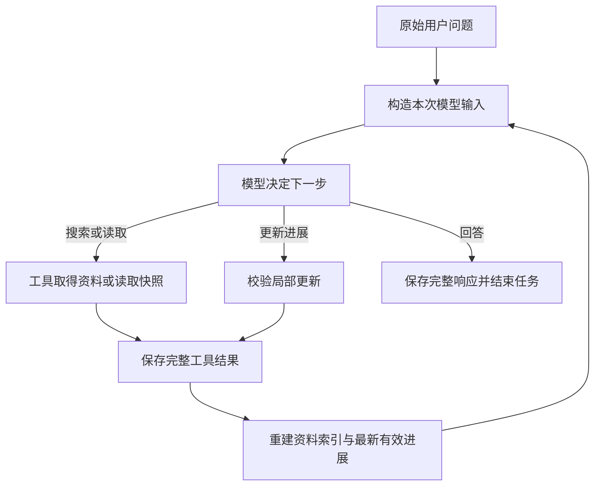

# 研究进展：状态、引用与发布

本文供维护资料与进展模块的开发者查阅。整体执行、预算整理与恢复见 [架构](architecture.md)，模型使用这些机制时的已知问题见 [研究发现](research-findings.md)。

## 1. 整体认识

研究进展是当前研究任务的可更新工作记录。模型提出发现、适用条件、未核实事项和下一步，harness 校验格式、引用及读取入口，保存到执行记录，并把最新有效版本放进后续输入。它的目的是在长任务和上下文整理后保留工作依据。同一任务的较早版本若仍留在输入中，会标为历史进展，注明已由新版替代，并保留当时的状态和导航；只有最新版本更新当前阅读导航。原始执行记录不被改写。

这条链路包含三个不同对象：

| 对象 | 保存什么 | 谁产生 | 可以证明什么 |
|---|---|---|---|
| 原文资料 | 搜索片段、提取文本快照、小节边界、获取信息 | 获取工具取得文本，harness 建索引 | 保存了哪份文本、位置在哪里；不能证明网页提取完整或结论正确 |
| 执行记录 | 问题、完整模型消息、工具开始/完成、输入选择、保存结果、结束状态 | 执行核心 | 客户端执行过什么、保存过什么、选入了什么 |
| 研究进展 | 模型的发现、条件、判断、缺口、阅读目标与计划 | 模型提出，harness 保存 | 某次任务当时记录了哪些判断；判断本身可能错 |

例如，“页面写了连续离线 30 天后需验证”要回查正文；“用户准备离线 45 天”来自用户问题；“模型曾保存了期限重置未知这一缺口”要回查对应任务的执行记录。三者不能相互代替。

模型一直通过工具调用与 harness 沟通。它可以自然语言向用户说明计划，但只有实际调用 `update_research` 并成功提交，才会发布新进展。

## 2. 来源与正文怎样成为决策依据

首次搜索仍向模型提供标题、实际 URL、相关片段及读取入口。后台保存的是取得的规范化结果；搜索不等于已提取每个 URL 的完整正文。

`read_page(url)` 联网提取页面、保存新快照，再返回开头正文和实际目录。后续本地读取原快照不会重新联网。再次调用 `read_page` 会再次获取；取得失败不能冒充新快照。

| 编号示例 | 含义 |
|---|---|
| `S1` | 同一目标 URL 的来源身份；当前按请求 URL 原样归并 |
| `S1-R1` | 一次搜索取得的片段 |
| `S1-P1` | 一次页面提取快照 |
| `S1-P1-H3` | 从该快照实际标题标记解析出的小节 |
| `S1-P1@820-1040` | 保存文本的 Python 字符串区间，从 0 开始、左闭右开；不是 JSON、字节或 token 偏移 |

片段与页面可以属于同一来源，但不是同一内容，也不能当成两个独立来源。多次查询与获取记录仍保留。同一 URL 的不同快照不合并覆盖范围。

小节名称和路径来自保存文本的明确标题，harness 不替作者发明语义标题。没有可靠目录时，模型可以查词或顺序阅读。这里的“原文”是保存的提取文本，不等同于完整 HTML 或网站全部内容。

| 工具 | 模型选择什么 | harness 负责什么 |
|---|---|---|
| `read_section` | 实际 `section_ref` 和返回的续读游标 | 按小节边界分页，尽量在自然段结束，不跨节 |
| `find_in_documents` | 查找词、资料、可选游标 | 区分大小写的字面匹配，返回命中附近正文与新引用 |
| `read_document(view="reference")` | 实际正文引用 | 只读引用范围，可分页 |
| `read_document(view="text")` | 资料或引用锚点 | 读取正文或展开周边，返回实际范围与新引用 |
| `read_document(view="outline")` | 已保存资料 | 返回目录及目录续读入口 |
| `list_documents` | 可选来源与游标 | 找回资料编号、获取信息和读取入口 |
| `list_history` / `read_history` | 记录编号与视图 | 回查执行经过；`review` 核对模型消息并绑定原任务、当时进展及快照；各视图偏移不可混用 |

`match_ref` 只定位命中词；`evidence_ref` 覆盖实际返回的附近正文。是否支持结论需要模型判断。未命中只说明所查文本没有该字面匹配。

常用默认值：搜索片段最多 1,200 字符，重复片段展示可缩为 200；首次读页约 1,800 字符；小节/普通正文单次最多 6,000 字符；目录单页 20 项。请求预算不足时可能进一步缩减，必须跟随实际范围和续读入口。

`complete` 表示本次是否包含整个读取目标；`reached_end` 只表示到达目标末端。末页到达末端，不表示本次包含此前全部正文。

## 3. 模型维护的完整状态

正式接口为 `update_research(base_revision, operations, goal=None, next_step=None)`。模型提交变化，harness 合并未修改内容并返回完整新状态。

| 内容 | 字段与含义 |
|---|---|
| 工作目标 | `goal`：模型概括的目标；不能替代原始用户问题 |
| 发现 | 稳定 `id`，`summary`、`conditions`、`status`、`references` |
| 发现的判断状态 | `supported`、`uncertain`、`conflicting`，均由模型选择，不是程序认证 |
| 正文引用 | 每项 1–8 个；可复制 `evidence_ref`，提交后规范化为来源、资料和区间 |
| 可选短原句 | `evidence_quotes`：每项最多三条，每条最多 400 字符；在关联引用范围内定位并保存实际原文与坐标 |
| 可选缺口关联 | `gap_ids`：发现或阅读目标关联最多四个仍存在的缺口 |
| 缺口 | 稳定 `id`、`question`、`status`、`resolution`、`references`；状态为 `open/resolved/dismissed` |
| 可选回答影响 | 缺口的 `answer_impact`：模型说明会改变哪项答案，或为何属于延伸问题 |
| 阅读目标 | 稳定 `id`，`target`、`view`、`purpose`，可带 `cursor/query/gap_ids` |
| 下一步 | `next_step`：模型的当前计划；省略保留旧值，空文本清除 |

阅读目标的 `view` 为 `section/text/reference/outline/find/page`。目标使用实际小节、资料、正文引用、明确 URL 或来源编号。程序核对目标是否存在和参数是否可解释，不验证目的是否合理。

支持的操作：

- 发现：`add_finding`、`revise_finding`、`remove_finding`。
- 缺口：`add_gap`、`revise_gap`、`resolve_gap`、`dismiss_gap`、`reopen_gap`、`remove_gap`。
- 阅读目标：`add_read_target`、`revise_read_target`、`remove_read_target`。

新增时分配 `finding-N/gap-N/target-N`，删除后不复用编号。修订、删除和关联应复制已返回编号。后端校验的是最终合并状态中的关联完整性；不能据此声称程序证明模型正确选择了关联。

`resolve_gap` 必须提交处理说明和正文引用。`dismiss_gap` 必须说明为什么不再调查，引用可为空。重新打开会清除旧解决说明与引用。解决缺口不会自动删阅读目标，也不会自动更改发现判断；这些由模型决定。

每版模型状态最多 8,000 个序列化字符，包含编号、关联、原句等；最多 20 项发现、20 项缺口、10 个目标。每次最多 20 项操作。超限时返回实际大小和需减少量，不静默截断条件。旧版全量参数保留 Python 兼容入口，已进入局部更新格式后不允许再用全量覆盖。

短原句先按字面定位，再允许内联 Markdown 链接文字、反斜线转义与空白折叠的格式等价匹配。不能翻译或改写后当作原句；格式匹配不唯一时要求缩小范围。程序不判断这条原句是否足以支持整项发现。

## 4. harness 生成的状态视图

下列信息由程序根据已保存状态与交付记录生成，模型不直接填入，也不计入上述 8,000 字符状态限额；它们仍占完整请求预算。

| 视图 | 内容与边界 |
|---|---|
| `navigation` | 阅读目标的实际来源、快照、原始标题、范围、读取动作 |
| `first_undelivered` | 顺序正文/小节/引用目标内最早未交付区间和动作；中间有洞时不能仅沿最后终点推进 |
| `document_coverage` | 正在引用或选择的资料，即使目标已删除也保留；最多显示八份和每份前三段，另列省略编号/数量 |
| `ever_delivered` | 本任务历史累计交付范围：`none/part/full` |
| `current_input` | 当前最终输入中的正文或短原句覆盖：`none/part/full` |
| `gap_links` | 每个缺口对应的发现、目标编号及缺口状态 |
| `state_budget` | 模型状态实际字符数、8,000 上限和剩余量 |
| `content_changed` | 相对上版是否有内容变化；空操作也可形成新保存点 |

当前不可见不等于从未交付；曾全部交付不等于已理解。片段的 `full` 仅指片段，不代表整页。`first_undelivered` 是入口，不是要求读完所有页面。

## 5. 一次更新怎样真正生效

1. 执行核心为模型构造本次消息和工具定义，其中包含原问题、可用资料和最新有效进展。
2. 模型返回完整、通过协议校验的工具调用，核心先保存完整响应，再执行调用。
3. `update_research` 检查正在运行的任务和 `base_revision`，在副本上合并整批操作。
4. 程序检查字段、数量、状态大小、对象关联、阅读入口、引用来源及范围；发现引用必须全部位于本任务已确认交付的连续范围内。不能用两端已读掩盖中间未读部分。
5. 校验通过只生成候选结果。`tool_completed` 成功落盘后，Session 才发布最新进展与记录编号。任何校验失败不替换旧版，版本仍保持不变。
6. 下一次输入重新生成导航和可见范围，并记录实际消息选择与替换值。

资料保存、准备选择、发起请求、确认交付是不同事件。`context_selected` 记录选择；`model_started` 发布本次阶段和请求投影；只有取得完整 `model_completed`，才根据实际投影确认正文交付。目录、预览、外置正文和只在后台保存的全文都不据此成为正文证据。

存储失败会停止运行，不能继续假定记录或状态已成功发布。取消发生在工具返回之后时，已经取得的结果也先保存。

## 6. 生命周期与恢复

### 6.1 平时如何使用

系统提示建议模型在重要发现或改变方向时保存。简单问题可以直接回答，不强制每轮调用进展工具。模型应更新过时的 `next_step`，根据原问题判断缺口是否必要，但目前没有程序语义检查来保证它做到。

Seekra 不设固定模型决策次数上限。停止取决于模型回答、取消、请求/存储/预算错误等运行条件。实验的外部计时取消与产品的决策上限不是一回事。

### 6.2 预算与恢复

接近请求字符预算时，执行核心先尝试利用已保存进展推进检查点和外置旧正文；仍需整理时，限制可用工具，安排一次正常模型决策保存进展。供应商续接数据丢失时，另由业务记录重建请求。两者都会保留原始记录与正文快照，具体选择顺序、阶段权限和失败边界见 [上下文管理](architecture.md#模型上下文如何控制大小)。

研究进展是模型维护的工作记录。检查点必须使用成功提交的版本；不能因为生成过候选更新，就把它当成可恢复状态。恢复后仍需区分曾经交付的正文与本次真正选入请求的正文。

### 6.3 任务、重载与 reset

恢复同一未完成任务继续其最新有效版本，但模型模式、提示词和工具配置必须兼容；已经开始、结果未知的工具不能自动重做。

新问题分配新任务编号，进展从版本 0 开始。旧任务进展属于历史资料，旧快照在当前会话允许范围内仍可查阅。reset 隔离当前资料索引与历史工具读取边界，磁盘原记录保留。

因此，当前任务的进展不能否定旧任务曾保存过什么。研究对象的来源、产生任务和当时状态需要分别核对。

模型消息的历史索引和普通回读提供 `review_action`。`read_history(view="review")` 返回该消息，并固定关联原问题、响应前最后一次已提交进展及当时获取/读取或引用的资料身份；后续更新和新快照不改写这些关联。没有当时进展时明确为 `null`，失败保存不成为关联版本。菜单最多八份资料，省略数量与后续定位入口明确列出。模型仍需选择相应入口核对；导航不认证语义，也不计为正文交付。该视图的 `start` 只属于模型消息文本，按返回的 `continuation` 续读。

## 7. 一个完整使用过程

问题：虚构产品 Windows 离线条件是什么，Pro、已下载资源包、共享访客账户连续离线 45 天是否可行？

1. 搜索片段提示有离线功能。模型根据标题、URL、片段决定打开来源。
2. 读页保存 `S1-P1`；目录提供 Supported platforms、Offline requirements、Limitations。开头正文仅支持部分条件。
3. 模型可保存已知条件，记录期限与账户缺口，选取实际小节为目标。没有读取正文的目录不能充当事实引用。
4. 模型读取相关小节，按 harness 返回的游标续读到末尾，取得 30 天后再次验证的句子；另读 Limitations，取得共享访客禁令。
5. 引用实际 `evidence_ref`，保存条件和短原句，按取得的依据更新缺口、目标及下一步。
6. 预算整理后，模型仍可依据这些记录回查同一快照。harness 不把读取完整等同于判断正确。
7. 回答指出两项已知不符。可以建议提前预留联网时间，但不能称原文要求提前；重置规则未确认时不能承诺周期方案成立。

步骤 1–6 的接口和保存机制已有实现与验证。步骤 7 的语义一致性仍不稳定，不能把前六步正常执行当作整份答案合格。

源码入口：[工具参数](../src/seekra/research.py)、[状态校验与局部更新](../src/seekra/progress.py)、[正文索引](../src/seekra/documents.py)、[会话重建](../src/seekra/session.py)。
